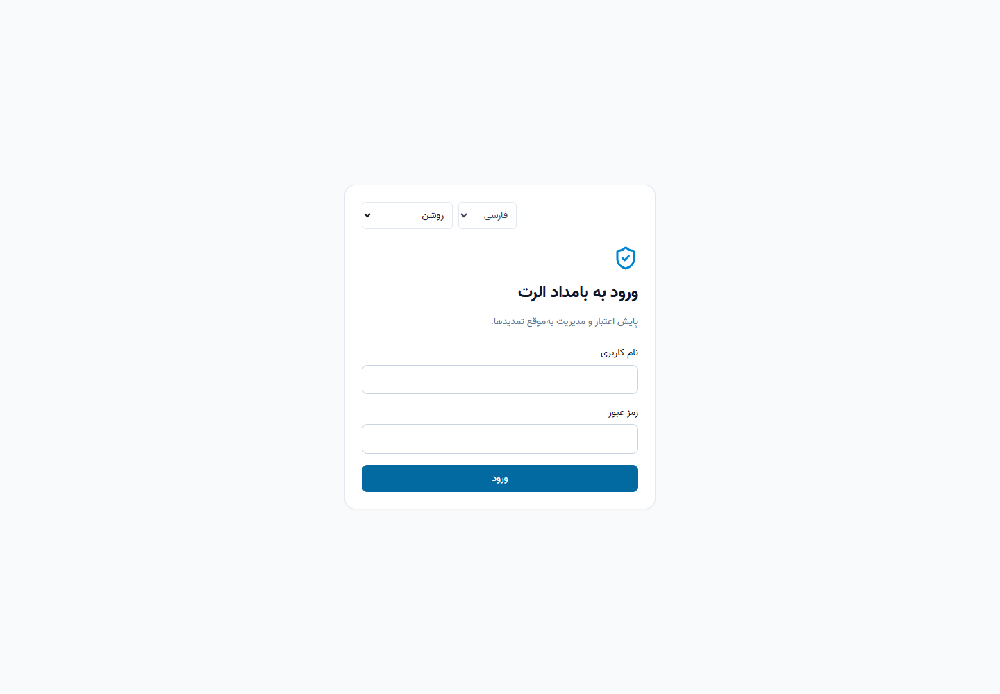
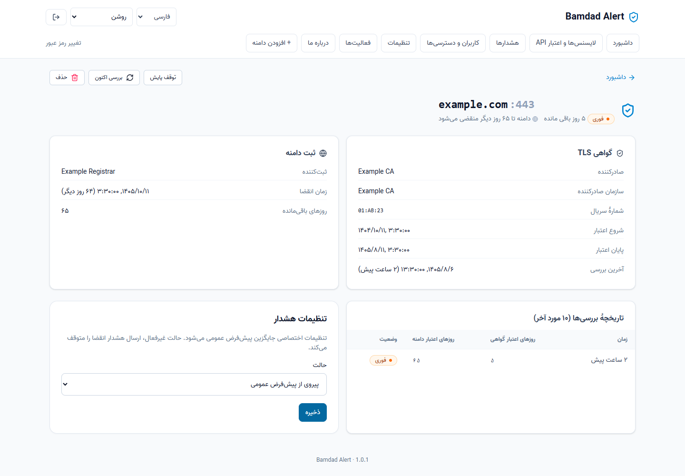
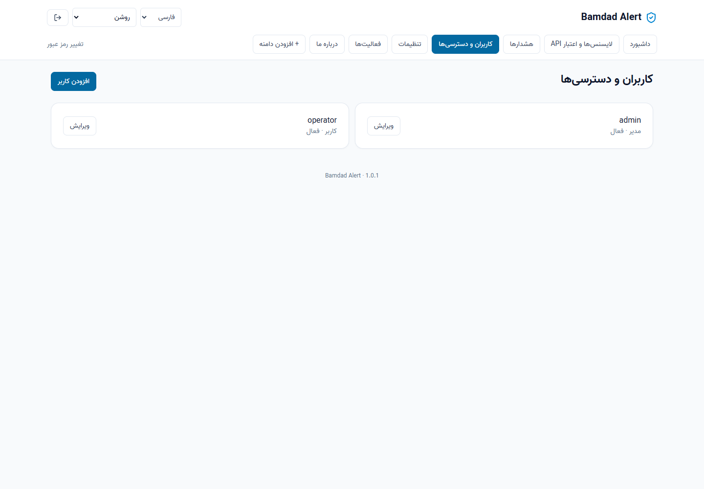
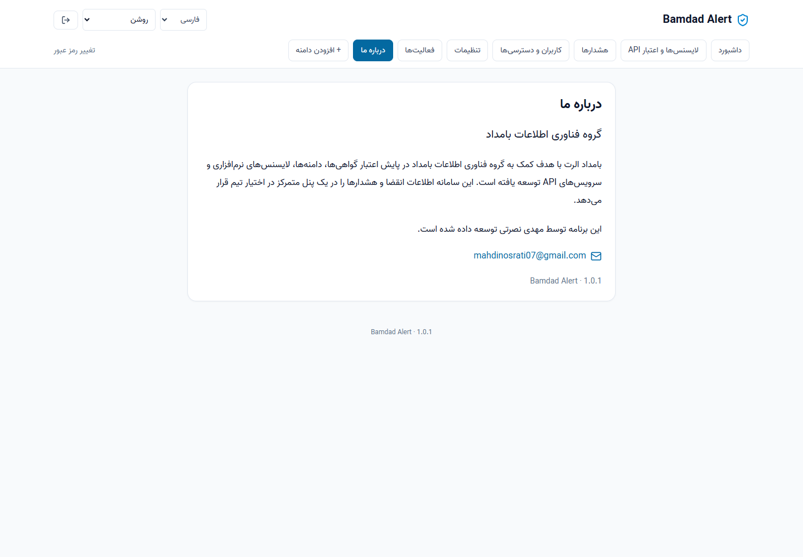
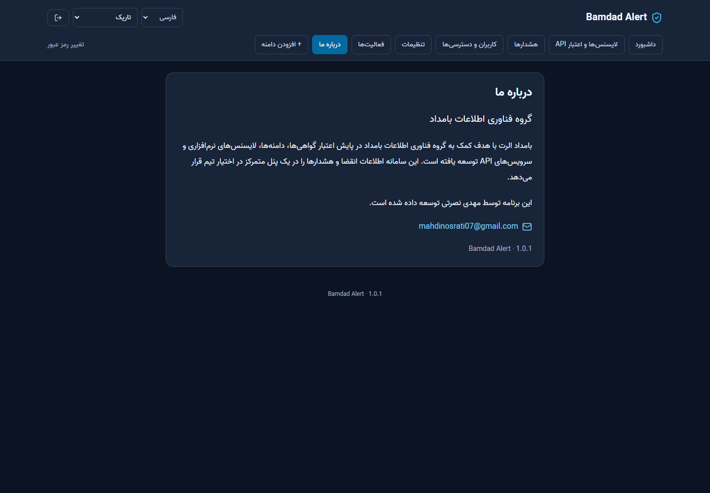

<div dir="rtl">

# بامداد الرت — راهنمای فارسی نسخهٔ ۱.۰.۱

[English](README.md) · [انتشارها](https://github.com/mahdinosrati/sslert/releases) · [تغییرات نسخه](docs/releases/1.0.1.md)

**Bamdad Alert** پنل گروه فناوری اطلاعات بامداد برای پایش انقضای گواهی SSL، ثبت دامنه، لایسنس نرم‌افزار و تاریخ اعتبار API است. زبان پیش‌فرض انگلیسی است؛ فارسی با فونت محلی وزیر و چیدمان راست‌به‌چپ در دسترس است. ظاهر روشن، تاریک و همگام با سیستم در مرورگر ذخیره می‌شود.

برنامه خودکار گواهی یا لایسنس تمدید نمی‌کند. تاریخ لایسنس و API دستی ثبت می‌شود؛ **خود توکن API ذخیره یا بررسی نمی‌شود**. پیامک در این نسخه وجود ندارد.

## ۱. نصب Docker روی Ubuntu 24.04

اگر Docker و Compose v2 دارید، این مرحله را رد کنید. دستورهای زیر برای نصب تازه‌اند. اگر بسته‌های Docker از منبع دیگری نصب شده‌اند، ابتدا بخش تداخل بسته‌ها در [راهنمای رسمی Docker برای Ubuntu](https://docs.docker.com/engine/install/ubuntu/) را بررسی کنید.

```bash
sudo apt update
sudo apt install -y ca-certificates curl git
sudo install -m 0755 -d /etc/apt/keyrings
sudo curl -fsSL https://download.docker.com/linux/ubuntu/gpg -o /etc/apt/keyrings/docker.asc
sudo chmod a+r /etc/apt/keyrings/docker.asc
sudo tee /etc/apt/sources.list.d/docker.sources >/dev/null <<EOF
Types: deb
URIs: https://download.docker.com/linux/ubuntu
Suites: noble
Components: stable
Architectures: $(dpkg --print-architecture)
Signed-By: /etc/apt/keyrings/docker.asc
EOF
sudo apt update
sudo apt install -y docker-ce docker-ce-cli containerd.io docker-buildx-plugin docker-compose-plugin
sudo systemctl enable --now docker
sudo docker compose version
sudo docker run --rm hello-world
```

پورت‌های منتشرشدهٔ Docker ممکن است قواعد UFW را دور بزنند؛ دسترسی اولیه را با فایروال میزبان/ارائه‌دهنده محدود کنید. برای دسترسی عمومی از HTTPS و reverse proxy استفاده کنید. مستندات رسمی Docker توضیح کامل شبکه و فایروال را دارد.

## ۲. دریافت نسخه و اجرای پنل

```bash
mkdir -p ~/apps
cd ~/apps
git clone --branch v1.0.1 https://github.com/mahdinosrati/sslert.git
cd sslert
cp .env.example .env
chmod 600 .env
nano .env
```

تنظیم‌های شروع:

```dotenv
WEB_PORT=5173
CHECK_INTERVAL=60
RESEND_API_KEY=
ALERT_EMAIL_FROM=alerts@YOUR_VERIFIED_DOMAIN
ALERT_EMAIL_TO=
SESSION_COOKIE_SECURE=0
```

برای ارسال واقعی ایمیل، کلید Resend و فرستندهٔ تأییدشده را تنظیم کنید. بدون کلید، پیام فقط در گزارش سرور ثبت می‌شود و پنل آن را «ثبت در گزارش سرور» نشان می‌دهد. برای HTTPS مقدار `SESSION_COOKIE_SECURE=1` بگذارید؛ روی HTTP، کوکی Secure ارسال نمی‌شود.

```bash
sudo docker compose up -d --build
sudo docker compose ps
sudo docker compose logs --tail=100 api web
```

نشانی پنل: `http://SERVER_IP:5173`. فقط سرویس وب به میزبان متصل است؛ API روی پورت داخلی ۳۰۰۰ و دیتابیس در volume موجود `sslert-data` باقی می‌ماند. نام مخزن، مسیرها و volume برای سازگاری ارتقا تغییر نکرده‌اند.

## ۳. ورود و تغییر رمز

- نام کاربری اولیه: `admin`
- رمز اولیه: `admin`

پس از ورود باید رمز جدید **حداقل ۱۲ نویسه‌ای** تعیین کنید؛ تا آن زمان سایر بخش‌ها قابل استفاده نیستند. این حساب فقط یک‌بار ساخته می‌شود و راه‌اندازی مجدد رمز را بازنشانی نمی‌کند. نشست ۱۲ ساعت اعتبار دارد. تغییر رمز، بازنشانی رمز یا تغییر دسترسی کاربر، نشست‌ها و توکن‌های دسترسی API او را باطل می‌کند.



از انتخابگر زبان، فارسی را انتخاب کنید. فونت وزیر همراه برنامه است و از سرویس ثالث دریافت نمی‌شود. زبان هشدار مستقل از زبان رابط و در تنظیمات هر ارتباط تعیین می‌شود.

## ۴. دامنه و گواهی SSL

۱. «افزودن دامنه» را بزنید؛ نام میزبان را بدون `https://` و مسیر وارد کنید.
۲. پورت معمول HTTPS برابر `443` است؛ `8443` نیز مجاز است.
۳. نتیجهٔ اولین بررسی و سپس جزئیات گواهی، RDAP/WHOIS و تاریخچه در صفحهٔ دامنه نمایش داده می‌شود.
۴. «بررسی اکنون» بررسی دستی را اجرا می‌کند؛ کاربران برای آن به مجوز ویرایش نیاز دارند.
۵. در همان صفحه، تنظیمات هشدار را عمومی، اختصاصی یا غیرفعال کنید.

نام‌های میزبان را جدا ثبت کنید. نبود اطلاعات RDAP/WHOIS الزاماً به معنی نامعتبر بودن گواهی نیست. دسترسی به آدرس‌های خصوصی و loopback به‌صورت پیش‌فرض مسدود است.



## ۵. لایسنس و اعتبار API

در «لایسنس‌ها و اعتبار API»، «افزودن مورد» را انتخاب کنید:

- نوع: لایسنس نرم‌افزار یا اعتبار API.
- عنوان، ارائه‌دهنده، مسئول پیگیری و یادداشت اختیاری.
- تاریخ انقضا به میلادی؛ اعتبار تا پایان همان روز UTC محاسبه می‌شود.
- لایسنس می‌تواند دائمی باشد؛ API حتماً تاریخ می‌خواهد.
- با خاموش‌کردن پایش، ارسال خودکار آن مورد متوقف می‌شود.

توکن واقعی یا کلید لایسنس را در یادداشت‌ها قرار ندهید؛ برای پایش فقط تاریخ کافی است. برنامه اعتبار واقعی، سهمیه یا لغو توکن در ارائه‌دهنده را بررسی نمی‌کند. موارد ایجادشده توسط کاربر خودکار به همان کاربر واگذار می‌شوند.


## ۶. ارتباط‌ها و هشدارها

ادمین در «هشدارها» ارتباط را یک‌بار تعریف می‌کند:

| کانال | تنظیمات |
| --- | --- |
| ایمیل | گیرنده، فرستنده، کلید Resend در `.env` |
| تلگرام | توکن ربات از BotFather و Chat ID؛ ربات باید امکان ارسال به مقصد داشته باشد |
| وب‌هوک | URL عمومی HTTPS؛ کلید امضای اختیاری ۱۶ تا ۲۵۶ نویسه |
| Slack | Incoming Webhook URL |
| ntfy | Topic و در صورت نیاز URL سرور |

برای هر ارتباط زبان فارسی یا انگلیسی انتخاب می‌شود. «ارسال آزمایشی» بدون انتظار برای انقضا پیام مشخصاً آزمایشی می‌فرستد؛ بین دو تست یک ارتباط باید ۳۰ ثانیه فاصله باشد. تست، سابقهٔ هشدار واقعی و جلوگیری از ارسال تکراری آن را تغییر نمی‌دهد. خطای ارسال در پنل اطلاعات محرمانهٔ ارائه‌دهنده را نمایش نمی‌دهد.

در «پیش‌فرض عمومی هشدارها»، ارتباط‌های عمومی، روزهای یادآوری مثل `30,7,1,0` و فاصلهٔ تکرار مثل `24` ساعت را تعیین کنید. اگر فهرست ارتباط‌ها خالی باشد، هشداری ارسال نمی‌شود.

برای هر دامنه، لایسنس یا API:

- **پیروی از پیش‌فرض عمومی:** از ارتباط‌ها و زمان‌بندی عمومی استفاده می‌کند.
- **اختصاصی:** انتخاب ارتباط‌ها و زمان‌بندی فقط برای همان مورد؛ جایگزین عمومی است و با آن جمع نمی‌شود.
- **غیرفعال:** هشدار انقضا ارسال نمی‌شود.

عدد صفر یعنی انقضا یا گذشته از انقضا. در هر بررسی نزدیک‌ترین آستانهٔ رسیده انتخاب می‌شود و برای هر مورد/منبع/ارتباط/آستانه تا پایان فاصلهٔ تکرار دوباره ارسال نمی‌شود. تلاش ناموفق هم تا پایان همان فاصله تکرار نمی‌شود؛ برای عیب‌یابی از تست استفاده کنید. پایش لایسنس/API در همان نوبت زمان‌بندی دامنه‌ها اجرا می‌شود. `CHECK_INTERVAL=60` یعنی ابتدای هر ساعت؛ در cron فعلی مقدارهای نامنظم مانند ۹۰ دقیقه به اجرای ساعتی برمی‌گردند.

کاربر فقط ارتباط‌های مجاز را می‌بیند؛ اطلاعات ربات و مقصدهای محرمانه از پاسخ او حذف می‌شود. گزینهٔ «کاربران بتوانند این ارتباط را انتخاب کنند» ارتباط را برای انتخاب کاربران در دسترس قرار می‌دهد. ارتباط‌های عمومی و ارتباط‌های قبلاً واگذارشده نیز قابل انتخاب‌اند. تعریف/ویرایش خود ارتباط با ادمین است.


## ۷. کاربران و دسترسی‌ها

ادمین در «کاربران و دسترسی‌ها» حساب می‌سازد، دامنه‌ها و لایسنس/APIها را واگذار می‌کند و سه مجوز مستقل می‌دهد: ثبت مورد، ویرایش موارد واگذارشده، ارسال آزمایشی. کاربر همیشه فقط موارد واگذارشده را می‌بیند. حذف، مدیریت کاربران، تنظیمات سرور و گزارش کامل فعالیت‌ها مخصوص مدیر است.

رمز حساب تازه و رمز بازنشانی‌شده باید در اولین ورود تغییر کند. آخرین مدیر فعال قابل غیرفعال‌کردن یا تنزل نقش نیست. غیرفعال‌کردن کاربر دسترسی او را می‌بندد.



## ۸. تغییر پورت

در «تنظیمات» پورت درخواستی را ذخیره کنید. سپس از پوشهٔ پروژه روی سرور دستور نمایش‌داده‌شده را اجرا کنید؛ مثلاً:

```bash
cd ~/apps/sslert
sudo bash scripts/set-web-port.sh 8080
```

ذخیره در پنل به‌تنهایی پورت را تغییر نمی‌دهد. اسکریپت پورت را بررسی می‌کند، از `.env` نسخهٔ پشتیبان می‌گیرد و فقط سرویس وب را بازسازی می‌کند؛ در صورت خطا تنظیم قبلی را برمی‌گرداند. پس از موفقیت نشانی جدید را باز کنید و قواعد فایروال/reverse proxy را هماهنگ کنید. فایل پشتیبان `.env.before-port.*` حاوی تنظیمات محرمانه است.

## ۹. ارتقا از نسخه‌های قبلی

ابتدا از دیتابیس و `.env` پشتیبان بگیرید. نمونهٔ نسخهٔ پشتیبان سازگار SQLite:

```bash
cd ~/apps/sslert
mkdir -p backups
chmod 700 backups
sudo docker compose exec --user 10001:10001 api node -e 'const D=require("better-sqlite3"); const d=new D("/app/data/sslert.db"); d.backup("/app/data/before-1.0.1.db").then(()=>d.close())'
sudo docker compose cp api:/app/data/before-1.0.1.db ./backups/before-1.0.1.db
cp .env backups/before-1.0.1.env
chmod 600 backups/*
git fetch origin --tags
git checkout v1.0.1
sudo docker compose up -d --build
sudo docker compose ps
```

اگر تغییر محلی دارید ابتدا آن را حفظ کنید؛ از reset اجباری استفاده نکنید. هرگز برای ارتقا `docker compose down -v` اجرا نکنید چون volume داده را حذف می‌کند.

Migrationها خودکار اجرا می‌شوند. گیرنده‌ها و زبان کانال‌های قبلی برای هر دامنه به سیاست اختصاصی منتقل می‌شوند؛ ارتقا ارتباط عمومی جدیدی را به دامنه‌های قبلی تحمیل نمی‌کند. `ALERT_EMAIL_TO` فقط هنگام اولین مهاجرت به ارتباط مرکزی وارد می‌شود؛ تغییرات بعدی گیرنده را از پنل انجام دهید. ورود توکنی قدیمی با حساب جایگزین شده است. توکن‌های قدیمی بدون مالک دیگر پذیرفته نمی‌شوند.

برای دسترسی برنامه‌نویسی، پس از تغییر رمز حساب، توکن وابسته به کاربر بسازید:

```bash
sudo docker compose exec --user 10001:10001 api node /app/dist/cli/tokens.js create --label automation --user admin
```

این توکن دسترسی همان کاربر را دارد و با تغییر حساب/رمز باطل می‌شود. این توکن ورود به API خود پنل با رکورد «تاریخ اعتبار API» تفاوت دارد.

برای برگشت به نسخهٔ قدیمی، سرویس را متوقف کنید، نسخهٔ پشتیبان دیتابیس و `.env` پیش از ارتقا را بازیابی کنید و کد نسخهٔ قبلی را اجرا کنید؛ دیتابیس مهاجرت‌یافته را با نسخهٔ قدیمی استفاده نکنید.

## ۱۰. ظاهر و درباره ما





تمام تصاویر از رابط واقعی با داده‌های نمایشی و بدون کلید واقعی تهیه شده‌اند. نام برنامه **Bamdad Alert** است؛ بخش درباره ما در هر زبان متن همان زبان را نشان می‌دهد. برنامه توسط **مهدی نصرتی** توسعه داده شده است؛ تماس: [mahdinosrati07@gmail.com](mailto:mahdinosrati07@gmail.com).

مجوز اصلی پروژه و انتساب‌های متن‌باز در [LICENSE](LICENSE) حفظ شده‌اند.

</div>
