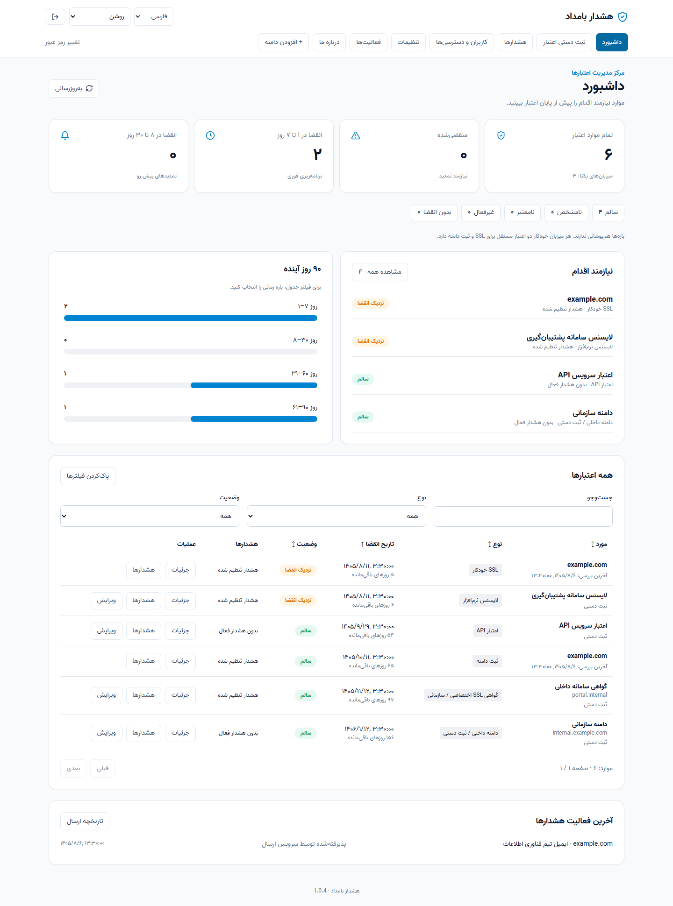
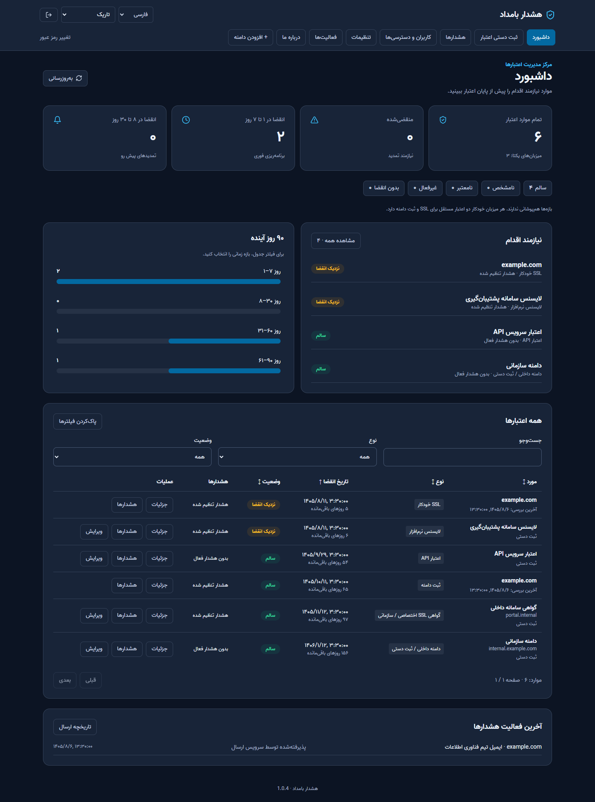
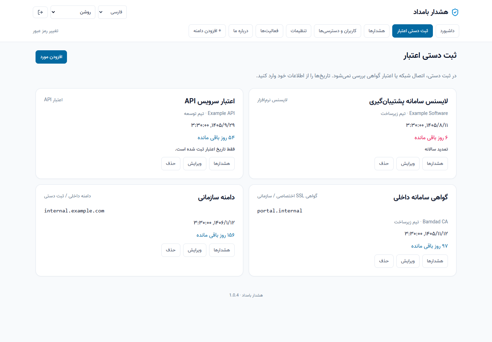
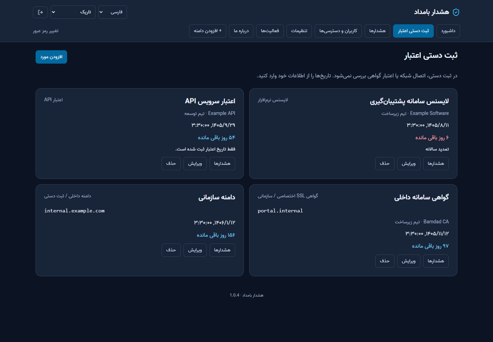
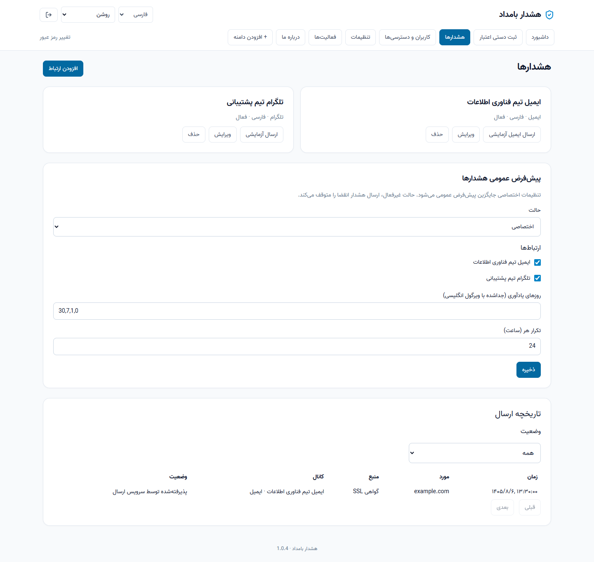
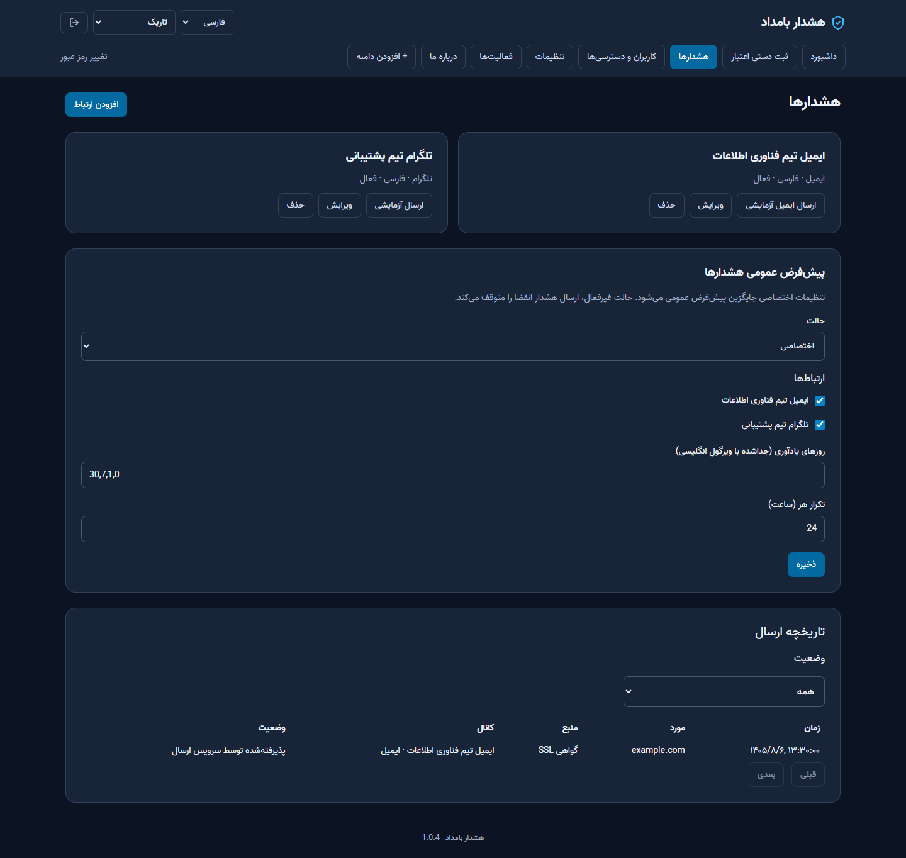

# Bamdad Alert 1.0.4

Self-hosted monitoring for SSL certificates, domain registrations, software licenses and API expiry dates. Built for the Bamdad Information Technology Group.

[راهنمای فارسی و نصب Ubuntu 24.04](README.fa.md) · [Release notes](docs/releases/1.0.4.md) · [API guide](docs/API-1.0.1.md) · [AGPL-3.0](LICENSE)

English is the default. Persian includes RTL layout and bundled Vazir fonts. Choose light, dark or system appearance. The bilingual About page credits Mahdi Nosrati and links to [mahdinosrati07@gmail.com](mailto:mahdinosrati07@gmail.com).

## Quick start

Install Docker Engine and Compose v2 using the [official Ubuntu instructions](https://docs.docker.com/engine/install/ubuntu/), then:

```bash
git clone --branch v1.0.4 https://github.com/mahdinosrati/sslert.git
cd sslert
cp .env.example .env
chmod 600 .env
sudo docker compose up -d --build
sudo docker compose ps
```

Open `http://SERVER_IP:5173`. Initial credentials are **admin / admin**. Changing the password to at least 12 characters is mandatory before accessing the panel. The initial account is created once and never reset on restart. Use HTTPS for public deployments and set `SESSION_COOKIE_SECURE=1` behind your HTTPS proxy. Keep it `0` for local HTTP.

The repository slug, npm workspace names and `sslert-data` volume remain unchanged for upgrade compatibility. The application display name is **Bamdad Alert**.

## Manual internal domains and organizational SSL

Use **Manual expiry records → Add item** and select Manual domain or Private SSL certificate. Enter hostname, title, issuer/registrar and expiry. Certificates also support valid-from date and serial number. These records do not connect to the target or validate certificate chains; notifications use the entered dates. Existing account assignments and global/custom alert policies also apply. No certificate private key is stored.

Login now has a Show password checkbox and centered branding. The browser tab uses the application shield logo; Persian branding is «هشدار بامداد». About offers accessible icon links for developer email and Telegram.

## Monitor items

- **Domains:** add a hostname without a URL scheme/path and port 443 (8443 also supported). Certificate checks use TLS; registration dates use RDAP/WHOIS. Private targets are blocked by default. Use Check Now for a manual check.
- **Licenses:** record a title, provider, responsible person, notes and expiry date, or mark the license perpetual.
- **API expiry:** record the expiry date manually. No API token secret is collected, stored or validated. No provider quota/revocation checks are performed.
- Manual expiry dates are Gregorian dates valid through the end of that UTC day. Disabled/perpetual records do not produce expiry alerts.

## Notifications

Define reusable connections under Notifications: email (Resend), Telegram, webhook, Slack or ntfy. Choose an independent English/Persian message language for each connection. Email requires `RESEND_API_KEY` and a verified sender. Without the key, email is **logged only**, never reported as sent.

Send Test sends an explicitly labeled test without waiting for an expiry. Tests are throttled to one per connection per 30 seconds and do not consume real expiry deduplication windows. No actual email or Telegram delivery is claimed until the configured provider reports success.

Global defaults select receivers, reminder thresholds (default `30,7,1,0` days), and repetition interval (default 24 hours). Every domain/license/API record can inherit defaults, replace them with a custom policy, or disable notifications. Custom policies replace rather than add to defaults. Empty receiver lists send nothing. The most urgent matching threshold is used, independently per record/source/connection. Failed attempts also wait for the configured repeat interval; use the test button after correcting settings.

Connections marked available to users, global connections, and connections already assigned to their items may be selected by users. Connection credentials are visible/editable only to administrators. Recent delivery results appear in Notifications; history is retained for 365 days by default.

`CHECK_INTERVAL=60` runs checks at the start of every hour. License/API checks run in the same scheduler tick. The existing cron mapper supports minute steps below 60 and whole-hour intervals below 24 hours; other values such as 90 or 1440 fall back to hourly.

## Accounts and access

Administrators create accounts, assign domains/licenses/API records, and independently grant users permission to create records, edit assigned records and send test notifications. Users can view only assigned records. Records they create are automatically assigned to them. Deletion, account management, server settings, connection definitions/secrets and the full audit log are administrator-only. The last enabled administrator cannot be demoted or disabled.

Passwords use salted scrypt. Session cookies are HttpOnly and SameSite=Strict, expire after 12 hours, and mutating requests require `X-SSLert-Request: 1`. First login and password resets require a new password. Changing an account or its password revokes its sessions and API tokens. Login attempts are rate-limited. SMS is deferred.

## Configuration and port changes

| Variable | Purpose |
| --- | --- |
| `WEB_PORT` | Published web port, default 5173 |
| `CHECK_INTERVAL` | Scheduler setting, default 60 |
| `RESEND_API_KEY` | Email delivery key |
| `ALERT_EMAIL_FROM` | Default verified email sender |
| `ALERT_EMAIL_TO` | Imported as a central connection on first migration only |
| `SESSION_COOKIE_SECURE` | Set 1 for HTTPS, 0 for local HTTP |

Server Settings saves the requested port and displays a command. Run it manually on the Docker host from the repository directory:

```bash
sudo bash scripts/set-web-port.sh 8080
```

Saving in the UI does not change the active port. The script checks availability, backs up `.env`, recreates only `web`, and restores the previous configuration if application fails. Adjust firewall/proxy rules and reconnect to the new port. Protect `.env` backups, which contain secrets. The application has no Docker socket or host shell access.

## Upgrade and rollback

Back up the database and `.env` before upgrading. See the [complete Persian upgrade procedure](README.fa.md#۹-ارتقا-از-نسخههای-قبلی) for an online SQLite snapshot command. Fetch tags, check out `v1.0.4`, then run `sudo docker compose up -d --build`. Preserve local modifications first. Never use `docker compose down -v` during upgrades.

Migrations preserve old domains, checks and channels. Existing receiver configurations become per-domain custom policies; global email fallback is imported where applicable. Subsequent connection changes belong in the central Notifications UI. Legacy `/domains/:id/channels` configuration is retired after migration.

Old ownerless bearer tokens are rejected. Sign in with admin/admin and change the initial password. Automation can create a new token bound to an enabled user who has changed their password:

```bash
sudo docker compose exec --user 10001:10001 api node /app/dist/cli/tokens.js create --label automation --user admin
```

These authentication tokens are distinct from monitored API expiry records. They inherit their owner's permissions. To roll back, stop the app, restore the pre-upgrade database and `.env`, check out the previous revision, and rebuild. Do not run old code against the migrated database.

## Screenshots

Actual UI with synthetic example data; no real secrets or real monitoring results.

| Light | Dark |
| --- | --- |
|  |  |
|  |  |
|  |  |

## Development

Node.js 22 is recommended for the native SQLite dependency.

```bash
npm ci
npm run typecheck
npm test
npm run build
npm run dev:api
# In another terminal:
npm run dev:web
```

`AUTH_DISABLED=1` is a development-only bypass and is rejected in production. Local data uses `data/sslert.db`. Browser tests: `npx playwright test --config packages/web/playwright.i18n.config.ts`; use `SSLERT_BROWSER_CHANNEL=msedge` for installed Edge. Set `SSLERT_DOC_SCREENSHOTS=1` to refresh documentation screenshots with fixture data. Backend tests cover real database migrations, authorization and dispatch with mocked transports. Provider credentials are required for live delivery verification.

## License and upstream

AGPL-3.0; original license and upstream attribution are retained. Based on [SSLert](https://github.com/einperegrin/sslert). Bamdad additions developed by Mahdi Nosrati.

## 1.0.3: unified dashboard and organizational email

The dashboard lists automatic SSL, domain registration and all manual expiry records with status cards, search and filters. Each automatic hostname contributes two independently monitored expiry entries. User access restrictions apply to both rows and counts.

Administrators can delete accounts after typing the username. The current account and last enabled administrator cannot be deleted. Sessions/tokens are revoked; monitored records remain. Password visibility applies only to newly entered passwords.

In Notifications, choose Email → SMTP, enter host, port, TLS mode, optional authentication, sender name/address and recipient, then save and send a test. STARTTLS is required when selected (usually port 587); implicit TLS usually uses 465. Plain SMTP is an explicit option for internal relays. Certificate verification remains enabled; mount your organizational CA and configure `NODE_EXTRA_CA_CERTS` if needed. SMTP transport uses [Nodemailer](https://nodemailer.com/smtp).

Resend remains available, with a per-connection API key or the server `RESEND_API_KEY` fallback. Without a key, Resend-mode delivery is logged only. SMTP passwords and per-connection Resend keys are encrypted with AES-256-GCM and never returned by the API. Blank password edits preserve the saved value; disabling SMTP authentication removes its password. The key is generated beside the database as `notification.key` (Docker: `/app/data/notification.key`). Securely preserve it separately with database backups; the legacy backup CLI does not export it. Losing the key requires re-entering connection credentials.

History includes target/connection names, channel, time and result, with status filtering and 50-row pagination. Accepted means the delivery service accepted the message, not guaranteed inbox delivery. Users see history only for assigned targets.

## 1.0.4: action-oriented dashboard and multiple email recipients

The dashboard separates unique host counts from expiry records, shows non-overlapping 1–7 and 8–30 day cards, highlights actionable records, and offers clickable 1–7/8–30/31–60/61–90 day bars. Disabled items are excluded from future-expiry bins. The table supports search, type/status filters, sortable columns and 15-row pages, with direct resource edit/policy links. Latest checks and delivery activity retain user access restrictions.

Alert coverage reflects the effective global/custom policy and enabled connections; Resend without an API key is not counted as active delivery coverage. Coverage does not guarantee successful delivery.

Email connections accept 1–50 recipients as an address array or comma/semicolon/newline-separated text. Invalid addresses are rejected and duplicates removed. Existing single-address connections remain compatible. Save the connection, then select **Send test email** to test all saved recipients (30-second cooldown). SMTP partial rejection is recorded as `partial`, not success. Recipients are included in To and can see the other addresses. Delivery-service acceptance does not guarantee inbox placement.

New endpoint: `GET /api/notifications/coverage` returns scoped target-key → boolean coverage without connection secrets. `GET /api/notifications/history?status=partial` filters partial deliveries.
